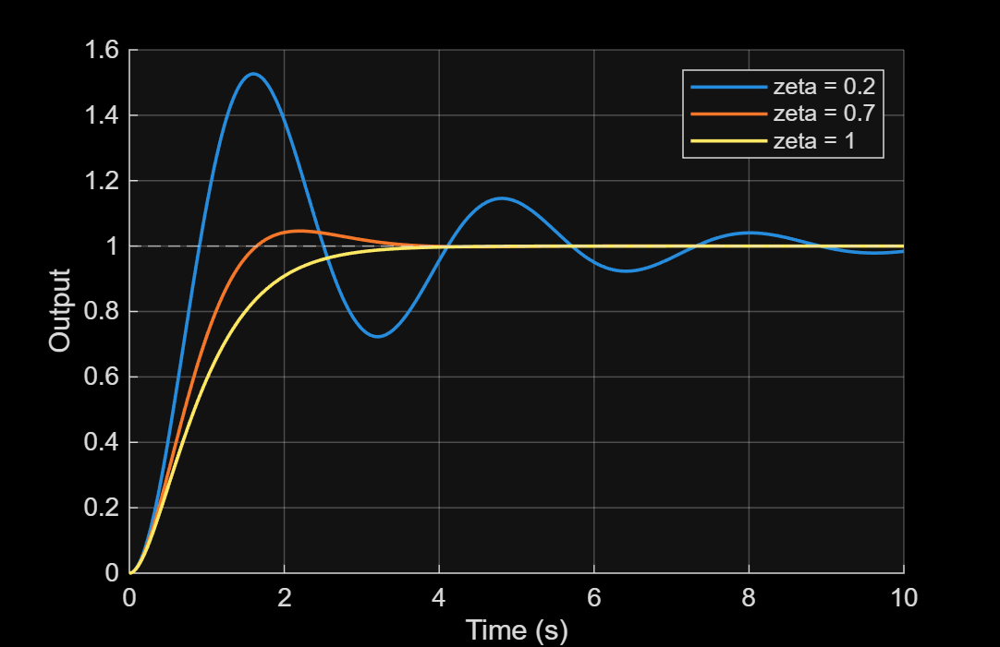
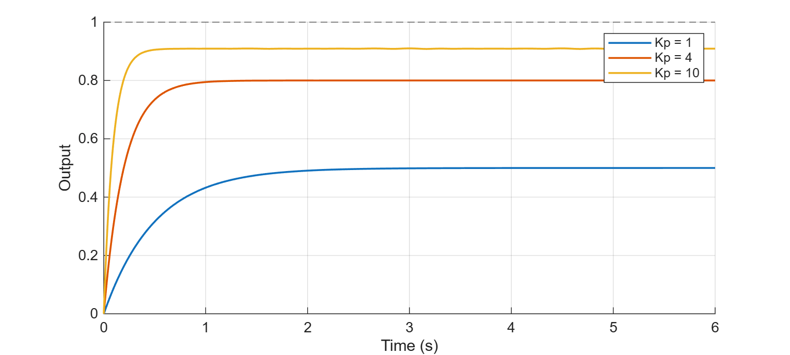
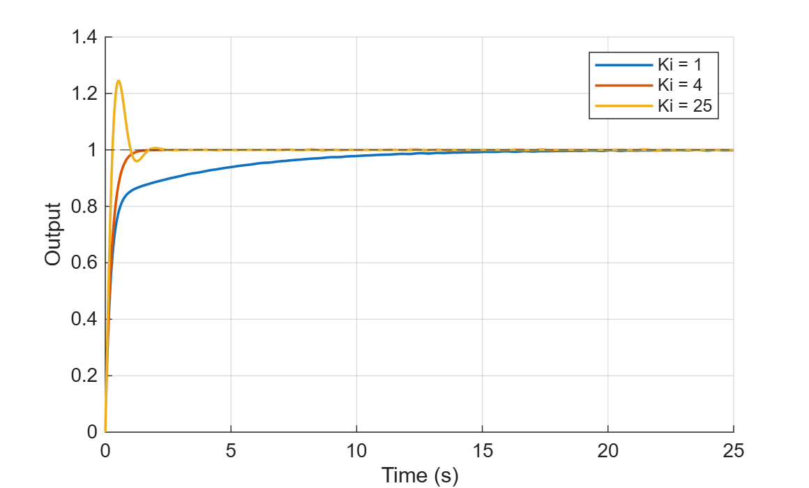
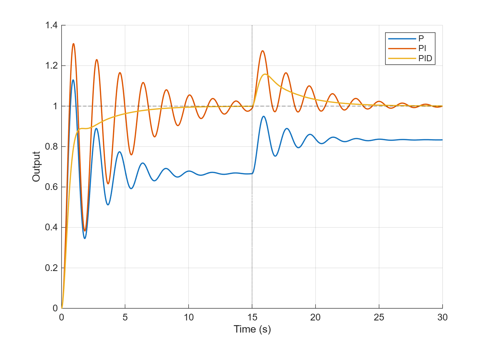

# Control Exercises (MATLAB / Simulink)

Step-response exercises from the control part of my learning plan. All systems are simulated.

| File | Topic | What I found |
|---|---|---|
| `ex7_first_order_step.m`, `first_order.slx` | Step response of a first-order system, tau = 0.5, 1, 2 | Measured 10-90% rise time = 1.10, 2.20 and 4.39 s (2.2 tau). 2% settling time = 1.96, 3.91 and 7.83 s, i.e. tau*ln(50) = 3.91 tau, which the usual "4 tau" rule rounds. The output reaches 63.2% of its final value at t = tau. It is the same math as exponential smoothing in `dsp/ex6` (a = e^(-T/tau)). |
| `ex8_second_order.m`, `second_order.slx` | Step response of a second-order system, wn = 2 rad/s, zeta = 0.2, 0.7, 1 | Measured overshoot 52.6% / 4.6% / 0% against the formula's 52.7% / 4.6% / 0%. Poles are -0.4 +/- 1.96j, -1.4 +/- 1.43j and -2 (double). The real part sets how fast the oscillation decays, the imaginary part sets its frequency. zeta of about 0.7 is a good compromise between speed and overshoot. |

| `ex9_p_control.m` | P control of a first-order plant, Kp = 1, 4, 10 | Steady-state error is 1/(1+Kp): 0.500, 0.200 and 0.091. Settling time shrinks as 1/(1+Kp): 1.96, 0.79 and 0.36 s. P alone cannot reach zero error at a reasonable gain, and a very high Kp would amplify noise and hit actuator limits. |

| `ex10_pi_control.m` | PI control, Kp = 4, Ki = 1, 4, 25 | The integrator removes the steady-state error (final value 1.000). Overshoot is 0.0 / 0.1 / 24.5%. The closed loop has a zero at -Ki/Kp, so the ex8 formula underestimates the overshoot (16.3% predicted for Ki = 25). At Ki = 4 the zero cancels a pole and the response is first order (settling 0.98 s). |

| `ex11_pid_disturbance.m` | P, PI and PID on a lightly damped second-order plant (wn = 2, zeta = 0.2) with a constant disturbance of 0.5 at t = 15 s | P leaves a steady-state error (0.667 before the disturbance, 0.833 after). The integral term returns the output to 1.000 after the disturbance. PI rings strongly (31% overshoot on the step). Adding the derivative term (acting on the measurement) damps it: no overshoot on the step, and it recovers fastest from the disturbance. |

## Next
- Feedback control with P, PI and PID on a simple plant ✅
- Sensor noise and filter delay inside a control loop
