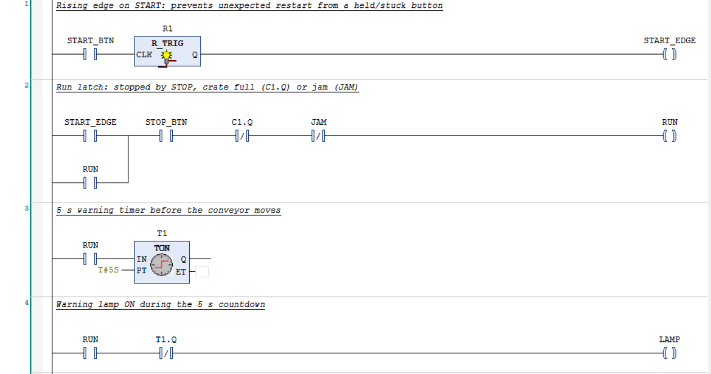
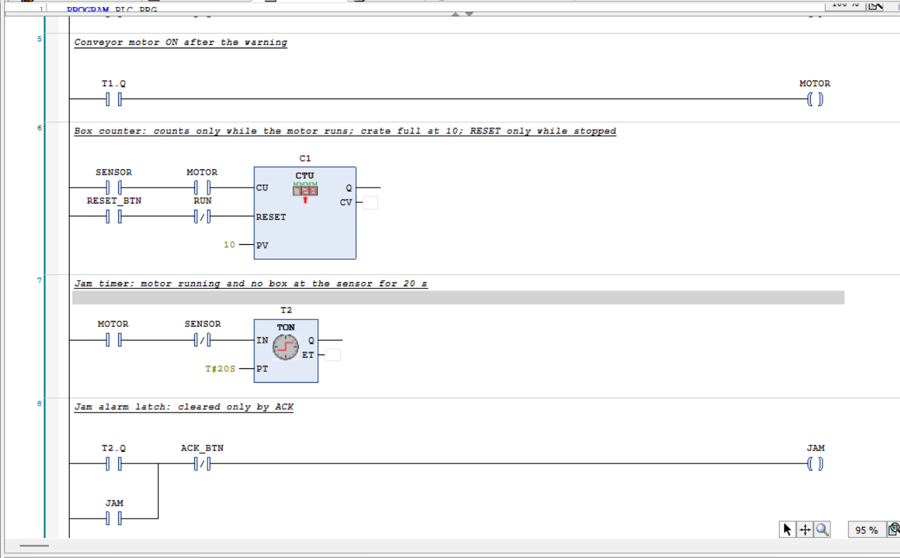
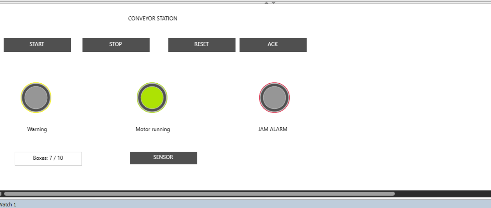
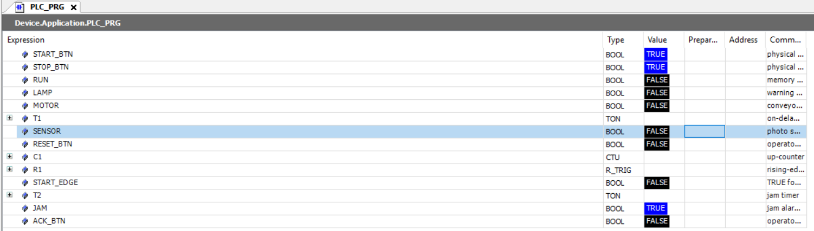

# Conveyor Station – PLC Ladder Logic (CODESYS, IEC 61131-3)

A conveyor that fills a crate with boxes, written in **ladder logic** and tested on a simulated PLC (CODESYS Control Win V3, simulation mode).
The goal was not only to make it run, but to add the safety and fault-handling logic a real machine needs.

## What it does

1. **START** → a warning lamp turns on for **5 s**, then the conveyor motor starts (people near the belt get time to step away).
2. A photo sensor counts boxes. After **10 boxes** the crate is full and the conveyor stops.
3. The operator swaps the crate, presses **RESET**, then **START** again.
4. If the motor runs but **no box reaches the sensor for 20 s**, the belt is probably jammed: the conveyor stops and a **JAM alarm** latches until the operator presses **ACK**.

## I/O and internal variables

| Name | Type | Meaning |
|---|---|---|
| `START_BTN` | BOOL input | Start push button (physical NO) |
| `STOP_BTN` | BOOL input | Stop push button (physical **NC**, TRUE when not pressed) |
| `SENSOR` | BOOL input | Photo sensor, TRUE while a box blocks the beam |
| `RESET_BTN` | BOOL input | Resets the box counter |
| `ACK_BTN` | BOOL input | Acknowledges the jam alarm |
| `LAMP` | BOOL output | Warning lamp |
| `MOTOR` | BOOL output | Conveyor motor |
| `JAM` | BOOL output | Jam alarm (latched) |
| `RUN` | BOOL memory | Operator wants the conveyor running |
| `START_EDGE` | BOOL memory | TRUE for one scan when START is pressed |
| `R1` | R_TRIG | Rising-edge detector for START |
| `T1` | TON, 5 s | Start warning timer |
| `T2` | TON, 20 s | Jam timer |
| `C1` | CTU, PV = 10 | Box counter |

## Ladder logic (8 networks)

```
 1  START_BTN ──[R_TRIG R1]──────────────────────────────( START_EDGE )
 2  START_EDGE ─┬─ STOP_BTN ──┤/├ C1.Q ──┤/├ JAM ─────────( RUN )
    RUN ────────┘
 3  RUN ──[TON T1, PT = 5 s]
 4  RUN ──┤/├ T1.Q ──────────────────────────────────────( LAMP )
 5  T1.Q ────────────────────────────────────────────────( MOTOR )
 6  SENSOR ── MOTOR ──[CTU C1, PV = 10]   RESET ← RESET_BTN ──┤/├ RUN
 7  MOTOR ──┤/├ SENSOR ──[TON T2, PT = 20 s]
 8  T2.Q ─┬─ ┤/├ ACK_BTN ────────────────────────────────( JAM )
    JAM ──┘
```




## Design decisions

| Feature | How | Why |
|---|---|---|
| **Fail-safe STOP** | STOP is a physical NC button, read with a normal (NO) contact | A broken wire looks like "stop pressed", so the machine stops |
| **Stop-dominant latch** | STOP, crate-full and jam contacts in series after the seal-in branch | Any stop condition always wins, even while START is held |
| **No unexpected restart** | START is used on its **rising edge** (R_TRIG), not its level | A held or stuck START button cannot restart the conveyor after a reset or alarm; the operator must press START again on purpose |
| **Start warning** | TON 5 s before the motor runs; resets if STOP is pressed during the countdown | The full warning always plays before the belt moves |
| **Count only while running** | `SENSOR` in series with `MOTOR` on the counter input | Found from OPC UA logs: a sensor pulse while stopped made the count 11 in a 10-box crate |
| **RESET interlock** | `RESET_BTN` in series with `┤/├ RUN` | The counter cannot be reset while the belt runs, so a crate cannot be overfilled |
| **Jam detection** | TON counts while the motor runs and no box is at the sensor; every box resets it | 20 s of sensor silence while running = jam |
| **Latched alarm** | Seal-in on `JAM`, cleared only by `ACK_BTN` | Without the latch the motor would stop, the timer would reset and the motor would restart in a loop |

## Operator screen (HMI)

Built with CODESYS Visualization and tested online against the running program.



| Element | Type | PLC variable | Note |
|---|---|---|---|
| START | Button (tap) | `START_BTN` | TRUE while pressed |
| STOP | Button (tap FALSE) | `STOP_BTN` | Writes FALSE while pressed, so it behaves like a real NC stop button |
| RESET | Button (tap) | `RESET_BTN` | Only works while stopped (interlock in the PLC, not in the screen) |
| ACK | Button (tap) | `ACK_BTN` | Clears the jam alarm |
| SENSOR | Button (tap) | `SENSOR` | Simulates a box passing the photo sensor |
| Warning | Lamp, yellow | `LAMP` | Start warning |
| Motor running | Lamp, green | `MOTOR` | |
| JAM ALARM | Lamp, red | `JAM` | Latched fault |
| Boxes: n / 10 | Text with `%d` | `C1.CV` | Live crate count |

All safety logic stays in the PLC program. The screen only reads and writes variables, so the machine behaves the same whether it is operated from the HMI or from hardware buttons.

## Tests (simulation, all passed)

Tested with PV = 3 and jam time = 8 s to save time, then set to 10 boxes and 20 s and re-tested.

| # | Test | Expected | Result |
|---|---|---|---|
| 1 | Short START press | Lamp 5 s, then motor runs and stays on (seal-in) | ✅ |
| 2 | STOP during the 5 s warning | Everything stops; next START gives the full 5 s again | ✅ |
| 3 | Boxes counted while the sensor is held TRUE for 10 s | Counts 1 (rising edge only) | ✅ |
| 4 | Crate full | RUN, lamp and motor off; counter keeps its value | ✅ |
| 5 | START held + RESET after crate full | Conveyor stays stopped (no unexpected restart) | ✅ |
| 6 | RESET while running | Ignored, count continues | ✅ |
| 7 | One box every ~5 s | No jam alarm | ✅ |
| 8 | No box while running | JAM latches, everything stops, alarm stays after the timer resets | ✅ |
| 9 | ACK | Alarm cleared, conveyor does **not** restart until START is pressed | ✅ |



## What I learned

- A program that "works" on the happy path is not finished: most of the logic here is about stopping safely.
- Level vs edge: counters and start commands must react to the moment a signal changes, not to how long it stays on.
- Timers forget (TON resets when its input drops), counters and latches remember. Choosing the right one decides how a machine behaves after a fault.
- First debugging lesson: when START "does nothing", check the stop chain first.

## Files

| File | Content |
|---|---|
| `conveyor_station.project` | CODESYS V3.5 SP22 project |
| `conveyor_station.xml` | PLCopen XML export of the program (readable text, works in other IEC 61131-3 tools) |

## OPC UA

The program also runs on a CODESYS SoftPLC with its OPC UA server enabled; a Python client reads and logs it over an encrypted connection. See [`../opcua`](../opcua/README.md).

## Next

- Connect the logged machine states to the vibration anomaly detector in this repo
- Rebuild in Siemens TIA Portal (S7-1200)
