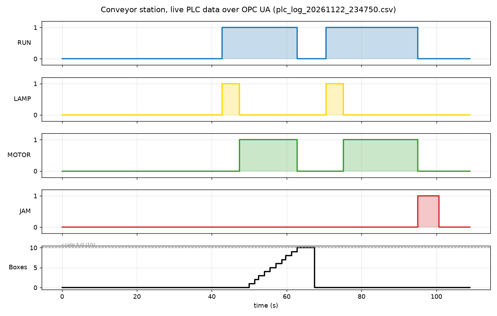

# OPC UA: reading the PLC from Python

The conveyor station PLC program (`../conveyor_station`) runs on a CODESYS SoftPLC. Its built-in OPC UA server publishes selected variables, and a Python script reads them live, logs them to CSV and plots one machine cycle.

```
 CODESYS SoftPLC (Control Win V3)                     Python (asyncua)
 ├─ PLC_PRG runs every scan                           read_plc.py  → logs/*.csv
 └─ OPC UA server :4840  ◄── Basic256Sha256 ──────►   plot_plc_log.py → plc_cycle.png
                             Sign & Encrypt + user login
```



The plot is a real recording (0.5 s sampling): start warning (5 s), motor, 10 boxes until the crate is full, reset, second start, no boxes for 20 s, jam alarm, acknowledge.

## Setup steps

1. **Real runtime instead of simulation.** Simulation mode runs inside the IDE and cannot be reached by other programs, so the program was downloaded to CODESYS Control Win V3 (SoftPLC, demo mode).
2. **Device user management.** The runtime enforces a login; an admin user was created on the device.
3. **Symbol configuration** with "Support OPC UA features". Only the variables outside systems need are published: buttons (`START_BTN`, `STOP_BTN`, `ACK_BTN`, `SENSOR`), outputs (`MOTOR`, `LAMP`, `JAM`), `RUN` and the counter `C1`. Internal helpers (`R1`, `START_EDGE`, `T1`, `T2`) stay hidden.
4. **Server certificate.** The OPC UA server only offered unencrypted endpoints until a certificate was created for it (Security Screen → Devices → Use cases → OPC UA Server).
5. **Client certificates.** UaExpert and the Python client each present their own certificate. The PLC quarantines unknown certificates; each one was moved to Trusted by hand.
6. **Verified with UaExpert** (read and write) before writing any code.

## Files

| File | Content |
|---|---|
| `read_plc.py` | Connects with Basic256Sha256 Sign & Encrypt and a PLC user, reads `MOTOR`, `LAMP`, `JAM`, `RUN`, `C1.CV` every 0.5 s, prints them and writes `logs/plc_log_<date>_<time>.csv` |
| `plot_plc_log.py` | Draws the timing diagram of the newest (or a given) log and saves `plc_cycle.png` |
| `logs/plc_log_20261122_234750.csv` | The recording shown above |
| `plc_cycle.png` | Timing diagram |

The client creates its certificate and private key in `pki/` on first run. That folder is in `.gitignore`: keys never go to Git. The password is read from the `PLC_PASSWORD` environment variable or asked hidden, never stored in the code.

```powershell
pip install asyncua matplotlib
$env:PLC_PASSWORD = "<your password>"   # this terminal session only
python read_plc.py                      # Ctrl+C to stop
python plot_plc_log.py
```

## Bug found through the data

The first logs showed the box count going to **11** in a 10-box crate: a sensor pulse while the conveyor was stopped (crate full) was still counted. The fix was one contact, `SENSOR` in series with `MOTOR` on the counter input, so boxes are only counted while the belt runs. The recording above confirms it: the count stays at 10 after the crate is full.

## Security notes

- The server refuses user/password logins on unencrypted endpoints, so credentials never travel in clear text.
- Every client must be explicitly trusted on the PLC.
- In a plant, the PLC network would also sit behind a firewall/DMZ (IEC 62443 zones and conduits); here everything runs on one laptop.

## Next

- Use the logged machine states as context for the vibration anomaly detector in this repo (e.g. only score vibration while `MOTOR` = 1)
- Rebuild the conveyor in Siemens TIA Portal (S7-1200) and read it with the same client
